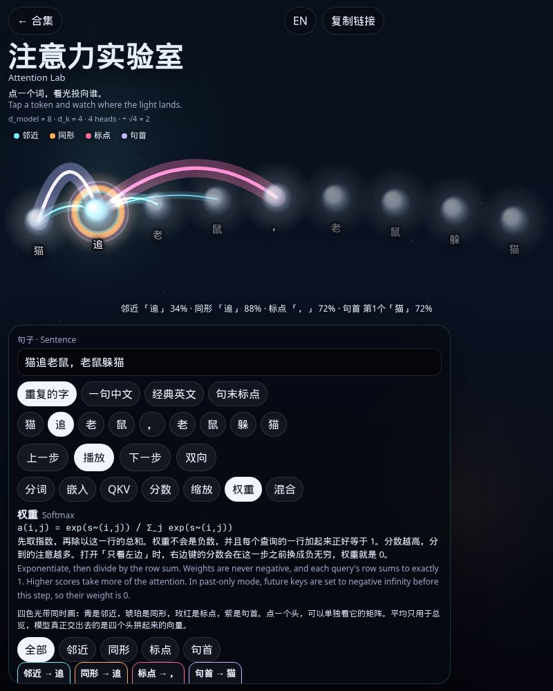
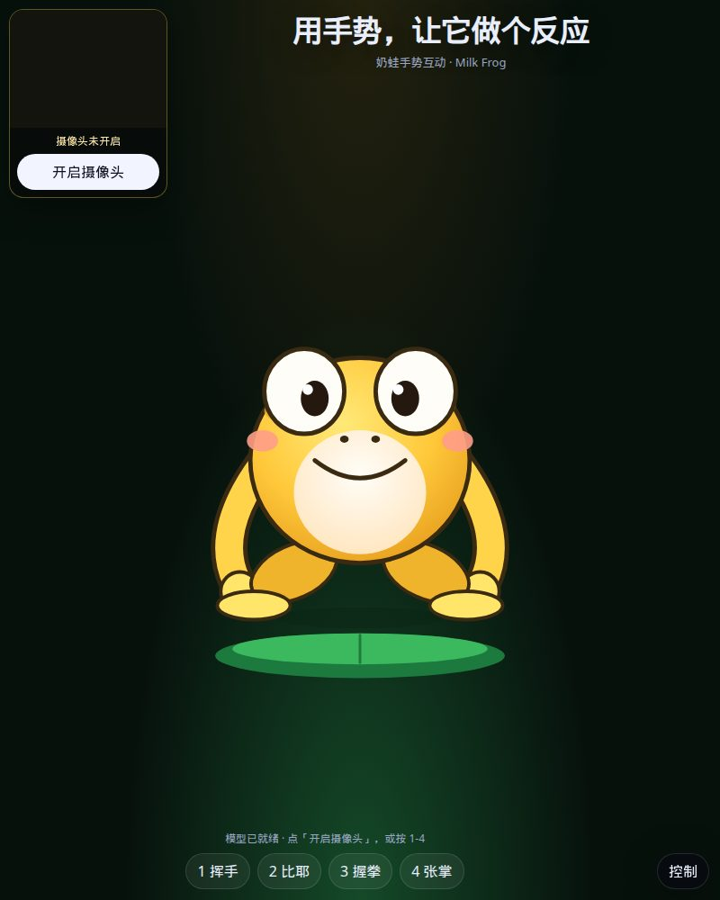
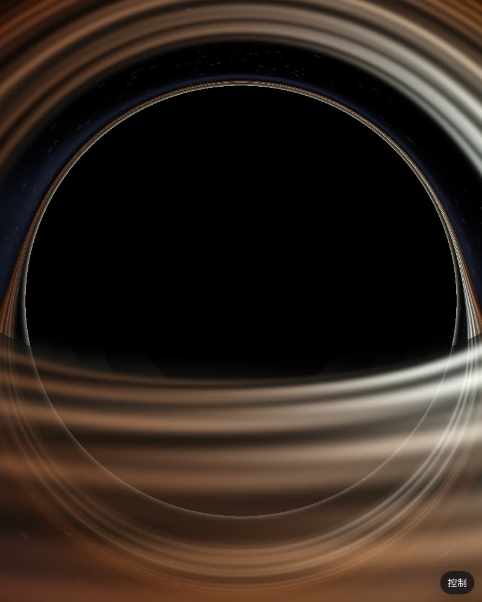
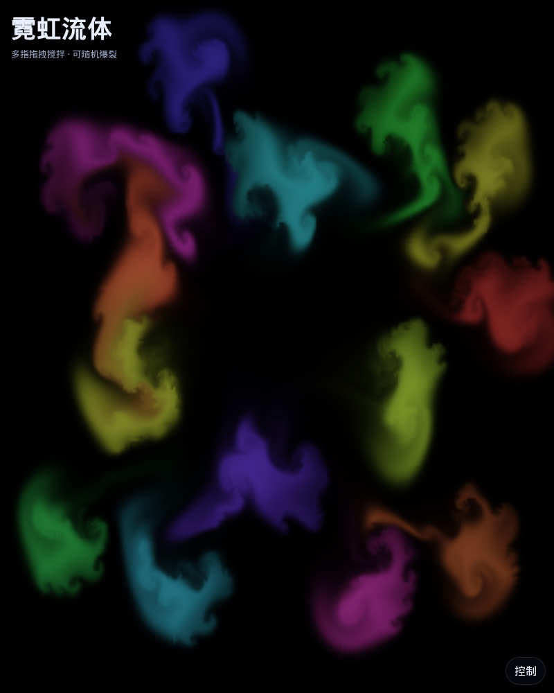
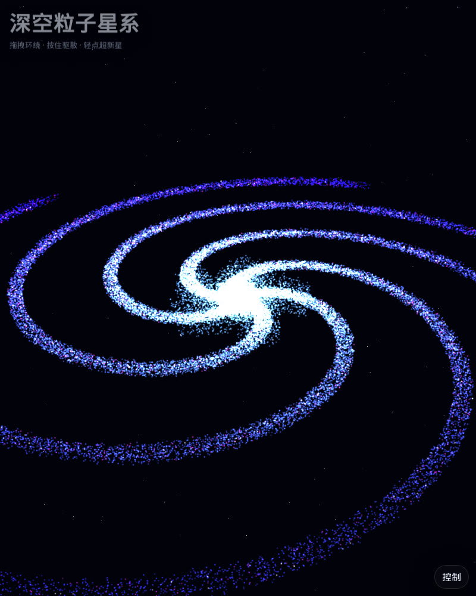
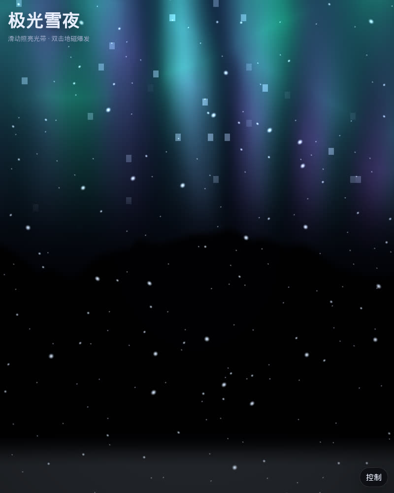
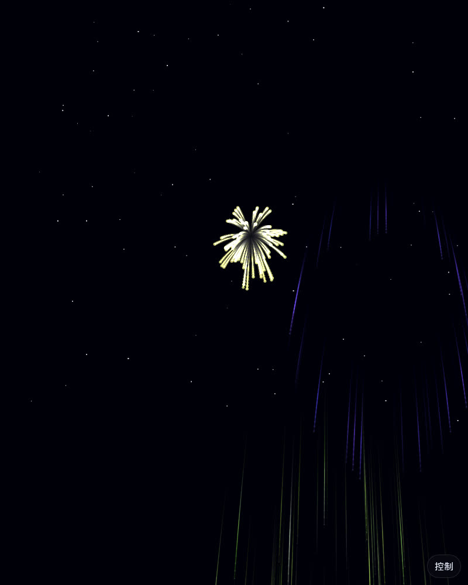
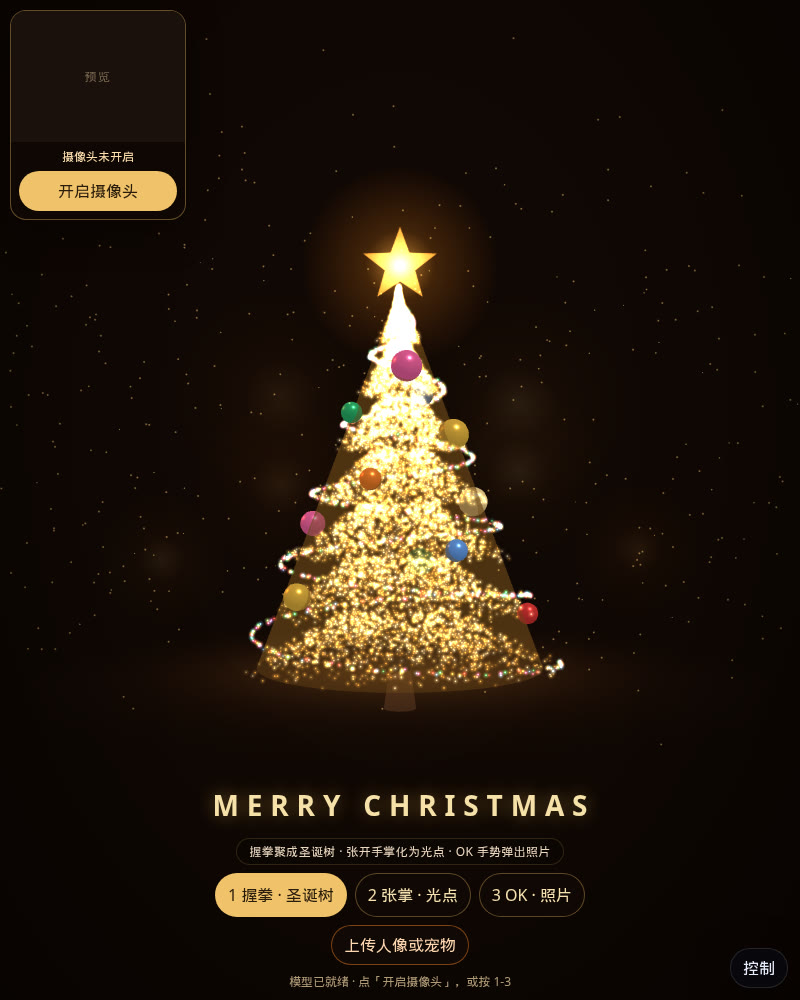
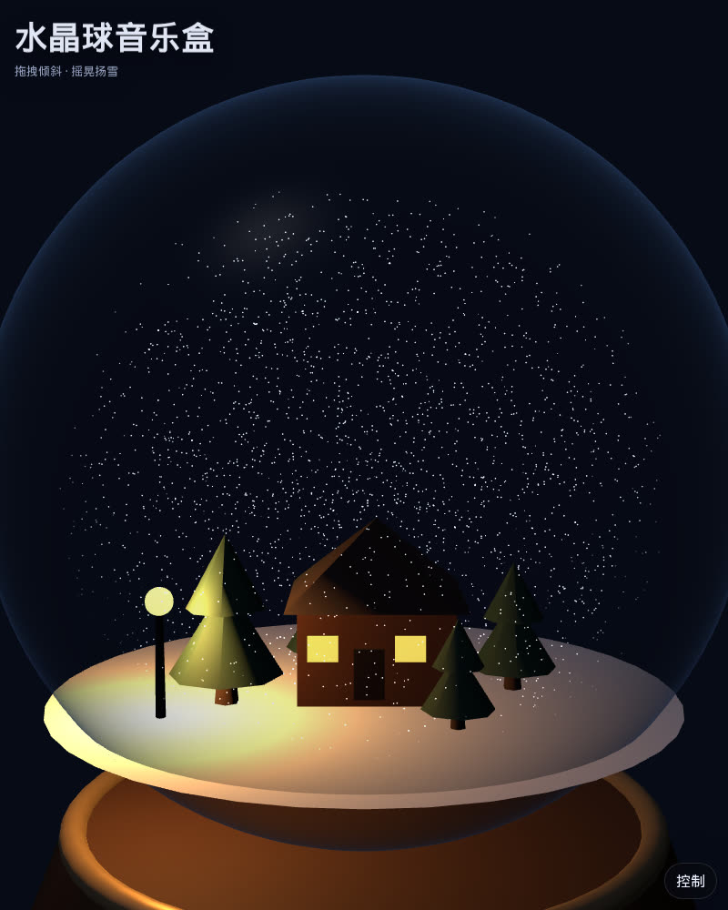
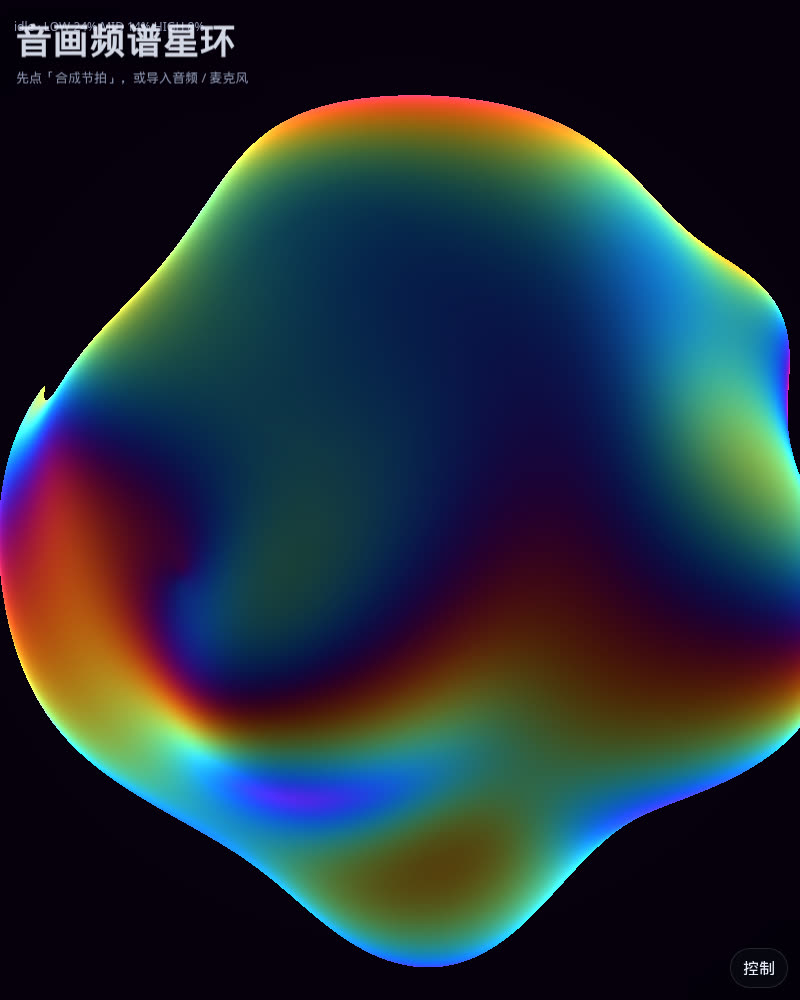

# 视觉特效合集 · Visual FX

Mobile-first visual scenes with **zero external network dependencies**. Built for GitHub Pages and in-app browsers such as WeChat.

**Live:** https://pengrunyi.github.io/visual-fx/

本地打包 Three.js、着色器与 Web Audio 合成，不加载任何外部脚本、字体或 CDN。适合在微信里直接打开全屏互动页，也可复制单场景直达链接。

## Scenes · 场景

<table>
  <tr>
    <td align="center"><a href="https://pengrunyi.github.io/visual-fx/attention/"></a><br><a href="https://pengrunyi.github.io/visual-fx/attention/">注意力实验室</a></td>
    <td align="center"><a href="https://pengrunyi.github.io/visual-fx/bunny/"></a><br><a href="https://pengrunyi.github.io/visual-fx/bunny/">兔耳装手势互动</a></td>
    <td align="center"><a href="https://pengrunyi.github.io/visual-fx/me/"></a><br><a href="https://pengrunyi.github.io/visual-fx/me/">真人手势互动</a></td>
  </tr>
  <tr>
    <td align="center"><a href="https://pengrunyi.github.io/visual-fx/milk-frog/"></a><br><a href="https://pengrunyi.github.io/visual-fx/milk-frog/">奶蛙手势互动</a></td>
    <td align="center"><a href="https://pengrunyi.github.io/visual-fx/black-hole/"></a><br><a href="https://pengrunyi.github.io/visual-fx/black-hole/">卡冈图雅黑洞</a></td>
    <td align="center"><a href="https://pengrunyi.github.io/visual-fx/fluid/"></a><br><a href="https://pengrunyi.github.io/visual-fx/fluid/">霓虹流体动力学</a></td>
  </tr>
  <tr>
    <td align="center"><a href="https://pengrunyi.github.io/visual-fx/galaxy/"></a><br><a href="https://pengrunyi.github.io/visual-fx/galaxy/">深空粒子星系</a></td>
    <td align="center"><a href="https://pengrunyi.github.io/visual-fx/aurora/"></a><br><a href="https://pengrunyi.github.io/visual-fx/aurora/">极光雪夜</a></td>
    <td align="center"><a href="https://pengrunyi.github.io/visual-fx/fireworks/"></a><br><a href="https://pengrunyi.github.io/visual-fx/fireworks/">夜空物理烟花</a></td>
  </tr>
  <tr>
    <td align="center"><a href="https://pengrunyi.github.io/visual-fx/christmas/"></a><br><a href="https://pengrunyi.github.io/visual-fx/christmas/">星光粒子圣诞树</a></td>
    <td align="center"><a href="https://pengrunyi.github.io/visual-fx/snow-globe/"></a><br><a href="https://pengrunyi.github.io/visual-fx/snow-globe/">3D 水晶球音乐盒</a></td>
    <td align="center"><a href="https://pengrunyi.github.io/visual-fx/music-reactor/"></a><br><a href="https://pengrunyi.github.io/visual-fx/music-reactor/">音画频谱星环</a></td>
  </tr>
</table>

## Routes · 路由

| Path | Scene |
| --- | --- |
| `/` | Gallery hub · 合集首页 |
| `/attention/` | 注意力实验室 · Attention Lab |
| `/bunny/` | 兔耳装手势互动 · Bunny Gesture |
| `/me/` | 真人手势互动 · Real Gesture |
| `/milk-frog/` | 奶蛙手势互动 · Milk Frog |
| `/black-hole/` | 卡冈图雅黑洞 · Gargantua |
| `/fluid/` | 霓虹流体动力学 · Neon Fluid |
| `/galaxy/` | 深空粒子星系 · Argon Galaxy |
| `/aurora/` | 极光雪夜 · GLSL Aurora |
| `/fireworks/` | 夜空物理烟花 · Firework Show |
| `/christmas/` | 星光粒子圣诞树 · Starlight Christmas |
| `/snow-globe/` | 3D 水晶球音乐盒 · Winter Snow Globe |
| `/music-reactor/` | 音画频谱星环 · Audio Shader Lab |

Christmas cards accept `?to=朋友&msg=圣诞快乐&from=署名`. The in-page editor copies a personalized link.

圣诞场景支持贺卡参数，页内可填写收礼人、祝福和署名并复制微信链接。

`/attention/`（注意力实验室）在浏览器里演算缩放点积注意力，不下载模型，也不访问网络。中文按字切开，英文按单词切开，标点单独成 token。四个手写的头分工不同：邻近看位置的正弦余弦，同形看相同的字，标点让内容词看向标点，句首让每个词看向第一个词。打开就能点词、换头、播放，或一步步看 Q、K、V、点积、除以 √d_k、Softmax 和加权混合。投影是教学用的，不是训练出来的；计算公式与 Transformer 的缩放点积注意力相同，输出矩阵 W_O 取单位映射。

Attention Lab computes scaled dot-product attention locally. It is a teaching model with hand-built projections, not a pretrained network.

奶蛙页用摄像头识别挥手、剪刀手、握拳和按住的张开手掌（也可按 `1-4`）。`@mediapipe/tasks-vision` 的 JS 打进包里；构建时把 `vision_wasm_internal` / `vision_wasm_nosimd_internal` 的 js 与 wasm 复制到 `dist/milk-frog/wasm/`。`public/milk-frog/hand_landmarker.task` 是已提交的 float16 手部模型（约 7.8MB，Apache-2.0）。页面只请求这些站内路径。

`/me/`（真人手势互动）和 `/bunny/`（兔耳装手势互动）共用同一套识别、wasm 和模型。`/me/` 是全身照；`/bunny/` 是贴边裁切的半身兔耳装，按各自 `layout.json` 叠头，跳的时候底边留在舞台渐变后面。

## Develop · 开发

```bash
npm install
npm run dev
npm test
npm run build
```

`npm run build` typechecks, bundles with Vite (`base: /visual-fx/`), then fails if `dist/` HTML, JS, or CSS contains an external URL. Allowed exceptions are W3C namespace identifiers (`http://www.w3.org/2000/svg`, the HTML namespace used by `createElementNS`) and a plain anchor to this GitHub repository.

## GitHub Pages

`.github/workflows/pages.yml` runs `npm ci`, `npm test`, and `npm run build` on pushes to `main` (and `workflow_dispatch`), then deploys `dist/` with `actions/deploy-pages`. In the repository settings, set Pages to **GitHub Actions**.

仓库 Pages 来源请选择 GitHub Actions。

## License

MIT © 2026 Pengrunyi
